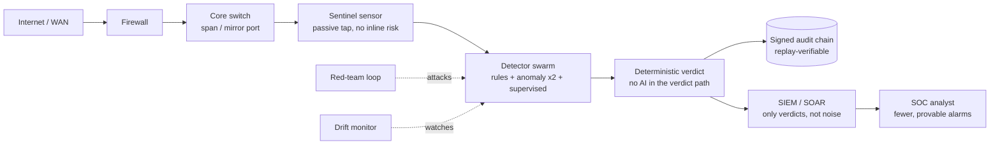
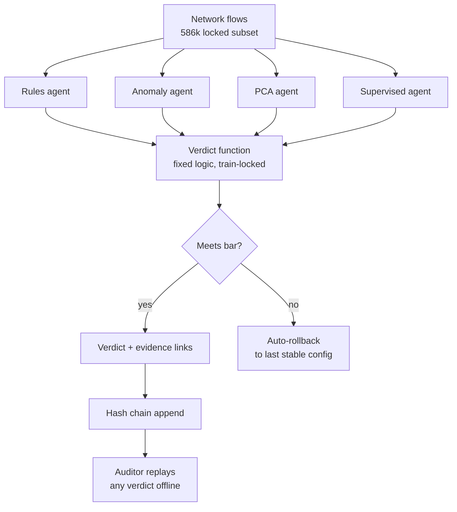

# AI Network Auditor — fewer false alarms from intrusion detection, with proof

**Deterministic swarm verdicts that cut IDS false positives, with signed audit trails.** If your SOC drowns in alerts, this shows a measured way to combine detectors into verdicts you can replay and audit — including the honest record of where the approach hit its limits.

**Who it's for:** SOC analysts fighting alert fatigue · detection engineers · researchers who need falsifiable IDS baselines · agent builders who need runtime guardrails (OWASP ASI).

## 60-second quickstart

```bash
git clone https://github.com/Gautham-AI-dev/ai-network-auditor
cd ai-network-auditor
pip install -r requirements.txt
kaggle datasets download -d chethuhn/network-intrusion-dataset \
  -p sentinel/data --unzip   # one-time (free Kaggle account)
python reproduce.py          # exit 0 = ALL MATCH (PASS)
```

## What it does

- 4 heterogeneous detector agents (rules, anomaly ×2, supervised) on a
  locked 586k-flow CICIDS2017 subset (DDoS + PortScan + benign).
- Deterministic adjudication: same inputs → byte-identical verdicts.
- Signed hash-chained audit log for every verdict (replay-verified).
- Red-team flood trials + graceful-degradation + determinism ablations.
- Full honesty record: the false-positive-reduction claim was FALSIFIED
  three ways with proof — the auditability that survived is the contribution.

## Results (measured, not marketed)

- Verdict never performs worse than the best lone detector (guardrail holds).
- 10× duplicate-alert flood: zero accuracy loss, sub-second.
- Bit-identical repeat runs (chain fingerprints match exactly).
- Novelty, targets, and failures: `docs/novelty-lock.md` (frozen).

## Where it sits in your network



The sensor is passive (a copy of traffic, never inline), so deploying it
cannot break the network. Analysts stop drowning because only adjudicated
verdicts — each with linked evidence — reach the SIEM, instead of every
detector shouting separately.

## How a verdict is made



## Keywords

intrusion detection, IDS, false positive reduction, alert correlation,
SOC, SIEM, SOAR, threat hunting, CICIDS2017, agent security, OWASP
agentic threats, audit trail, reproducible research, Python.

⭐️ If this helped your SOC or your research, star the repo — it keeps
falsifiable security work visible.
